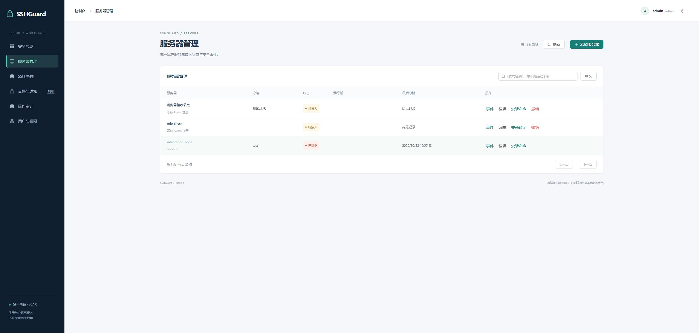
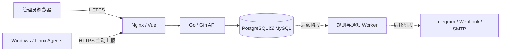

# SSHGuard

**面向多服务器环境的 SSH 安全审计与登录告警平台。** 管理后台集中查看资产和事件，Agent 主动通过 HTTPS 上报，无需保存服务器 SSH 密码或私钥。

[安装中央平台](docs/INSTALL-NATIVE.md) · [安装 Agent](docs/AGENTS.md) · [Docker Compose](docs/INSTALL-COMPOSE.md) · [下载构建](https://github.com/xiuzhenzhi/SSH/actions) · [版本发布](https://github.com/xiuzhenzhi/SSH/releases) · [产品路线图](docs/ROADMAP.md)

> **当前版本：0.2.0-alpha.1，基础预览版。** 已完成管理后台、认证权限、服务器管理、跨平台 Agent 注册/心跳与事件入库 API。**尚未实现真实 SSH 日志采集、规则引擎和通知发送。** 不要把 Agent 在线状态当作安全告警已经覆盖生产服务器。

## 能做什么

| 能力 | 当前状态 |
|---|---|
| 管理员登录、可撤销会话、admin/operator/viewer 权限 | 已实现 |
| 服务器分组、搜索、编辑、心跳状态、操作审计 | 已实现 |
| 后台生成短期、一次性 Agent 安装命令 | 已实现 |
| Windows / Ubuntu / Debian / Alpine Agent 注册、心跳、凭证撤销 | 已实现代码与构建；服务安装需目标机器验收 |
| SSH 事件批量入库、UUID 去重、查询、详情 | API 已实现；目前用于联调 |
| SSH 成功/失败日志采集、断线补传 | 下一阶段 |
| Root/高权限登录、失败阈值、IP 白名单规则 | 规划 |
| Telegram、Webhook、SMTP 通知与失败重试 | 规划 |



*界面来自独立测试库；上图不是实时生产数据。*

## 选一种部署方式

数据库和部署方式独立选择，**Docker 不是必选项**。

| 选择 | 适合场景 | 文档 |
|---|---|---|
| Go 二进制 + systemd + Nginx | 已有 Linux 主机、数据库和运维规范 | [原生部署](docs/INSTALL-NATIVE.md) |
| Docker Compose + Nginx | 希望应用和数据库一并启动 | [Compose 部署](docs/INSTALL-COMPOSE.md) |
| PostgreSQL 16 | 新部署或已有 PostgreSQL | 两套部署方案均支持 |
| MySQL 8.4 | 已有 MySQL 运维体系 | 两套部署方案均支持 |

数据库切换不会自动迁移已有数据。中央平台当前以 Linux 为部署目标；Agent 系统与中央平台系统可以不同。

### 快速体验：Compose + MySQL

准备 Git、Node.js、Docker Engine 和 Compose 2.24.4+：

```bash
git clone https://github.com/xiuzhenzhi/SSH.git
cd SSH
node scripts/init-env.mjs mysql http://localhost:8088
docker compose config --quiet
docker compose up -d --build
```

打开 **http://localhost:8088**。初始用户名 `admin`，随机密码在本机 `.env` 的 `ADMIN_PASSWORD` 中。生成器不会覆盖已有 `.env`。选择 PostgreSQL 时，将初始化命令中的 `mysql` 改成 `postgres`。

本地 HTTP 模式用于体验后台；正式接入 Agent 必须配置**公网域名 + 可信 HTTPS 证书**。生产步骤见安装文档，不使用默认密码或关闭证书验证。

### 不使用 Docker

从 [Releases](https://github.com/xiuzhenzhi/SSH/releases) 或成功的 [CI 运行](https://github.com/xiuzhenzhi/SSH/actions/workflows/ci.yml) 下载 `sshguard-linux-amd64.tar.gz`，ARM64 中央服务器选择 `arm64`。压缩包包含 API、已构建 Web、Agent 和部署模板，运行时不需要 Go/Node.js。

按照 [原生安装文档](docs/INSTALL-NATIVE.md) 创建数据库、配置 `/etc/sshguard/api.env`、证书及 Nginx，然后启动服务。源码编译见 [开发文档](docs/DEVELOPMENT.md)。

仓库为私有时，源码及 Actions/Release 下载需要有访问权限的 GitHub 账号。目标 Agent 从**你自己的平台域名**下载程序，不需要 GitHub Token。

## 接入服务器

1. 管理员登录，进入「服务器管理」，添加服务器名称与分组。
2. 点击「安装命令」，选择目标系统。
3. 在目标机器按提示执行命令；每台机器使用独立命令。
4. 确认主机名、系统信息和 Agent 版本出现，心跳状态变为在线。

| Agent 系统 | 服务方式 | 架构 | 安装环境 |
|---|---|---|---|
| Windows | 原生 SCM 服务，LocalService 账号 | amd64 / arm64 | 管理员 PowerShell 5.1+ |
| Ubuntu / Debian | systemd，专用 sshguard 用户 | amd64 / arm64 | sudo/root、curl、CA 证书 |
| Alpine | OpenRC，supervise-daemon | amd64 / arm64 | root、sh/ash、curl、CA 证书 |

Linux Agent 使用纯 Go 静态构建，Alpine 不依赖 glibc、Bash 或 sudo。详细依赖、凭证文件权限、日志位置、升级和卸载见 [Agent 手册](docs/AGENTS.md)。

安装凭证 **15 分钟内单次有效**；长期令牌只在目标机器保存，平台数据库只存哈希。撤销凭证会阻止后续上报。重装时生成新命令，不要克隆已注册的 Agent 配置。

## 自动构建与发布

- 提交 `main`、创建 PR 或手动运行 CI：执行 Linux/Windows Go 测试、PostgreSQL/MySQL 集成测试和 Vue 构建。
- `main`、手动运行及版本标签的检查通过后，再构建跨平台 Agent；在该运行的 **Artifacts → sshguard-release-assets** 下载产物，保留 14 天。PR 只检查，不重复打包分发。
- 推送与 `VERSION` 一致的 `v*` 标签：重新通过相同检查后，发布 **Prerelease**，包含两个中央平台包、四个 Agent、安装脚本和 `SHA256SUMS`。
- 普通 CI 只有仓库读取权限；仅发布任务拥有写入 Release 的权限。Action 依赖锁定到提交 SHA。

完整操作、版本规则与失败处理见 [构建发布文档](docs/RELEASING.md)。当前工作流不会自动部署或操作你的 70 多台服务器。

## 架构



API 负责会话、权限、校验与事务；Agent 不执行平台下发的任意 Shell 命令。通知 Worker 尚未实现，虚线为规划能力。

## 文档导航

| 文档 | 内容 |
|---|---|
| [原生安装](docs/INSTALL-NATIVE.md) / [Compose 安装](docs/INSTALL-COMPOSE.md) | 数据库、环境配置、Nginx、HTTPS 和启动 |
| [Agent 手册](docs/AGENTS.md) | 四种系统安装、权限、服务检查与卸载 |
| [运维手册](docs/OPERATIONS.md) | 升级、备份恢复、凭证撤销、健康检查 |
| [故障排查](docs/TROUBLESHOOTING.md) | 登录失败、离线、证书、数据库与安装问题 |
| [API 参考](docs/API.md) | 接口、权限、事件协议、错误和去重 |
| [开发测试](docs/DEVELOPMENT.md) / [构建发布](docs/RELEASING.md) | 源码运行、测试、Actions 和版本产物 |
| [产品需求与路线图](docs/ROADMAP.md) | 下一阶段优先级、边界和验收标准 |
| [验证记录](docs/VALIDATION.md) / [更新日志](CHANGELOG.md) | 已验证内容、限制与版本变化 |

问题和建议可通过仓库 Issues 提交；安全问题请按 [安全策略](SECURITY.md) 私下反馈。贡献说明见 [CONTRIBUTING.md](CONTRIBUTING.md)。
