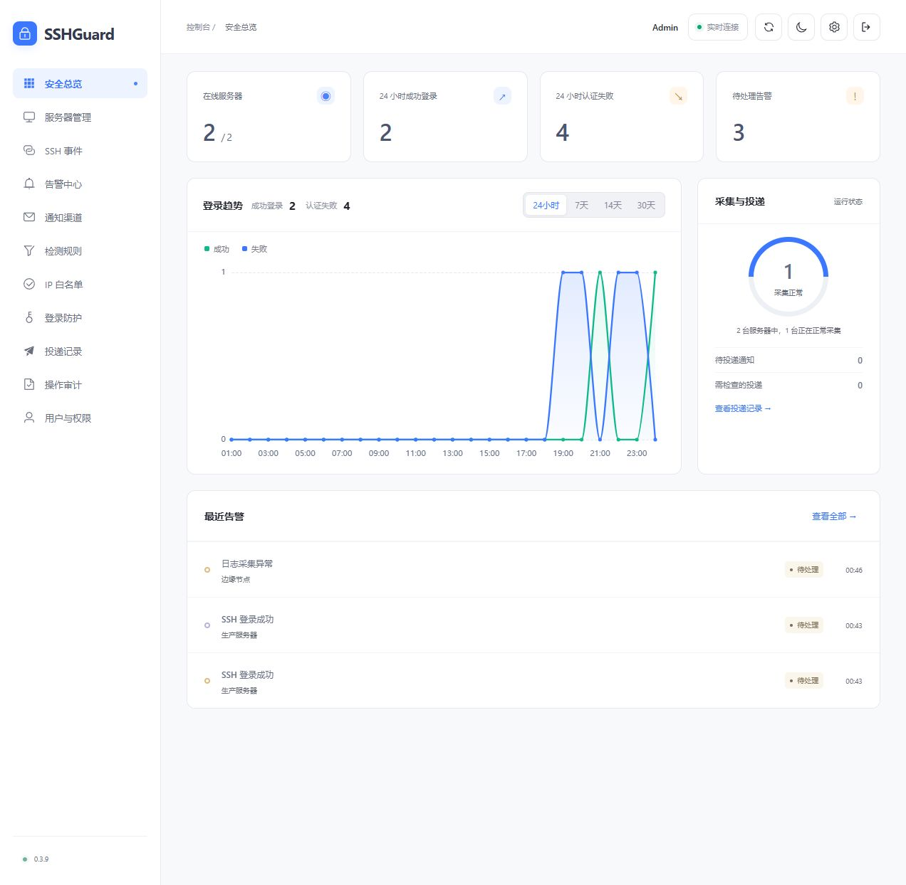

# SSHGuard

集中管理 Windows / Linux 服务器的 SSH 登录记录与安全告警。

## 功能

- SSH 审计：查看登录时间、用户、来源 IP、端口和认证结果。
- 安全告警：异常登录、连续认证失败、服务器离线与采集异常通知。
- 服务器管理：分组、IP 白名单、Agent 安装与远程更新。
- 登录防护：人机验证、登录错误封禁、用户权限与操作审计。

支持 Windows、Ubuntu、Debian、Alpine；数据库可选 SQLite、PostgreSQL 或 MySQL。



## 安装

主控使用 Ubuntu / Debian，默认通过 IP + 端口访问，使用 SQLite，无需域名或 Docker。

```sh
curl --proto '=https' --proto-redir '=https' --tlsv1.2 -fLsS https://raw.githubusercontent.com/xiuzhenzhi/SSHGuard/main/sshguard.sh -o sshguard.sh
sh sshguard.sh
```

更新主控：

```sh
sh sshguard.sh --update
```

v0.3.20 起使用新目录布局，旧目录安装不支持自动迁移，需使用旧版脚本卸载后重新安装。v0.3.19 用户请参考 [对应版本文档](https://github.com/xiuzhenzhi/SSHGuard/blob/v0.3.19/README.md)。

新布局下已安装的主控也可运行 `sh /opt/SSHGuard/Server/sshguard.sh --update`。管理菜单「1」安装，「9」更新。

## 文档

[在线文档](https://xiuzhenzhi.github.io/SSHGuard/)

[文档总览](docs/README.md) · [安装与管理](docs/guides/QUICKSTART.md) · [Compose 安装](docs/deployment/INSTALL-COMPOSE.md) · [Agent](docs/guides/AGENTS.md) · [反代与 HTTPS](docs/deployment/REVERSE-PROXY.md) · [告警配置](docs/guides/ALERTING.md) · [登录防护](docs/guides/LOGIN-SECURITY.md) · [数据库维护](docs/guides/DATABASE.md)

[更新日志](CHANGELOG.md) · [下载版本](https://github.com/xiuzhenzhi/SSHGuard/releases) · [参与贡献](CONTRIBUTING.md) · [安全反馈](SECURITY.md)
