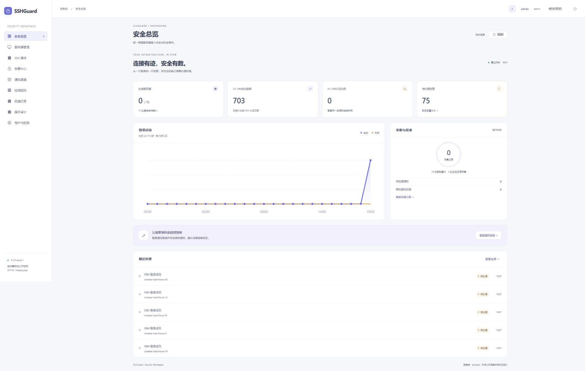
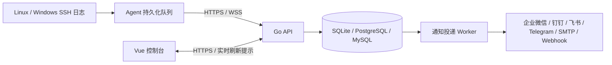

# SSHGuard

[](https://github.com/xiuzhenzhi/SSH/actions/workflows/ci.yml) [](https://github.com/xiuzhenzhi/SSH/actions/workflows/release.yml) [发布版本](https://github.com/xiuzhenzhi/SSH/releases)

面向多服务器环境的 SSH 登录审计与实时告警平台。Go API + Vue 控制台 + 轻量 Go Agent，数据库可选 PostgreSQL、MySQL（兼容 5.6.51）或 SQLite，Docker Compose 可选。

在一个控制台查看谁在什么时间、从哪里登录了哪台服务器；对异常登录、连续认证失败和采集离线配置通知。适合需要集中审计多台 Windows / Linux 主机的运维团队。

[一键部署](docs/QUICKSTART.md) · [Agent 安装更新](docs/AGENTS.md) · [告警配置](docs/ALERTING.md) · [生产验收](docs/PRODUCTION.md) · [Releases](https://github.com/xiuzhenzhi/SSH/releases) · [Actions](https://github.com/xiuzhenzhi/SSH/actions)

## 功能

- **安全概览**：在线资产、真实登录趋势、采集健康、待处理告警、通知投递状态；浅色响应式界面、实时刷新、减少动态效果偏好支持。
- **跨平台采集**：Windows OpenSSH/Operational，Ubuntu / Debian journal 或 auth.log，Alpine / Linux secure、messages；成功与失败认证、日志读取位置持久化。
- **可靠上报**：HTTPS + WebSocket；先保存到本地队列，事务提交后确认；断线重连、HTTPS 回退、同一事件 ID 去重。
- **检测与告警**：登录、root / Administrator 登录、认证失败阈值、Agent 离线、采集异常；分组、可信 CIDR、冷却时间、告警确认与健康恢复状态。
- **全部六类渠道**：企业微信、钉钉、飞书、Telegram、SMTP、通用 Webhook；加密保存配置、测试通知、持久化投递队列、重试和失败记录。
- **安装、更新和卸载**：后台生成安装/更新/卸载命令，支持管理员触发受限 Agent 更新；校验下载、保留身份、失败回退，无通用远程命令执行。中央平台支持原生部署向导或 Compose。
- **权限与运维**：admin / operator / viewer、会话撤销、修改密码、操作审计、过期数据分批清理。

Agent 主动出站连接平台，不保存服务器 SSH 密码或私钥，不接收任意远程 Shell 指令。版本由仓库 VERSION 与 Release 标签控制；仅从成功的 Actions 构建或已发布 Release 安装。生产适用性须按 [验收清单](docs/PRODUCTION.md) 在自己的目标系统验证，验证范围见 [验证记录](docs/VALIDATION.md)。

## 一键部署（无需 Docker）



*开发验收截图，包含隔离测试数据，不是生产服务器监控结果。*

中央平台推荐 Ubuntu / Debian + systemd。准备解析到平台主机的域名、80/443 端口和可信 HTTPS；私有仓库使用有权限的 GitHub 账号，先完成 gh auth login。

**版本提示：SQLite 从 v0.3.1 开始支持。** 下方一键入口下载固定版本 `v0.3.3`，安装前确认 [Releases](https://github.com/xiuzhenzhi/SSH/releases) 中该版本已构建完成并包含安装包；也可按下方 Compose 步骤从源码构建。

```sh
git clone https://github.com/xiuzhenzhi/SSH.git
cd SSH
sh scripts/quick-start.sh
```

向导下载固定版本、校验 SHA256，并配置 systemd。默认使用 SQLite，程序直接提供网页和 API，无需安装 Nginx 或数据库服务；也可复用已有 Nginx / OpenResty / 宝塔反向代理。独立模式支持现有证书启用内置 HTTPS；HTTP 可体验面板，接入 Agent 前须启用 HTTPS。数据库还可选择 PostgreSQL / MySQL。SQLite 数据位于 `/var/lib/sshguard-api/sshguard.db`，管理员初始密码及通知加密密钥保存在 root 专用的 `/etc/sshguard/api.env`。详见 [安装与管理](docs/QUICKSTART.md)。

更新平台：`sh scripts/quick-start.sh --update`。先备份数据库与 api.env，再更新平台、最后分批更新 Agent。自动回退恢复程序，**不逆向恢复数据库迁移**。离线包、无人值守配置、证书和迁移说明见 [快速开始](docs/QUICKSTART.md)。

安装脚本提供中文编号菜单：选择安装，端口回车即可，默认 SQLite，无需输入域名或选择反代。首次交互安装完成后直接显示访问地址、账号和初始密码。反代与 HTTPS 放在快速开始文档中，需要时再配置。

## Compose（可选）

```sh
git clone https://github.com/xiuzhenzhi/SSH.git
cd SSH
node scripts/init-env.mjs sqlite http://localhost:8088
docker compose config --quiet
docker compose up -d --build
```

打开 http://localhost:8088，用户名 admin，随机密码在 `.env`。示例使用无需独立数据库服务的 SQLite；需要 PostgreSQL / MySQL 时将 `sqlite` 改为 `postgres` / `mysql`。生成器拒绝覆盖已有 `.env`。本地 HTTP 仅用于体验，接入 Agent 必须启用可信 HTTPS。公网配置见 [Compose 安装](docs/INSTALL-COMPOSE.md)。已有 MySQL 5.6 使用外部数据库，不会自动升级你的数据库。

## SQLite 部署

SQLite 适合单机部署，无需独立数据库服务，首次启动自动创建完整业务表；登录审计、规则、通知和权限功能与其他数据库共用同一套 API。首次使用可直接执行上面的 Compose 命令。

数据库保存在命名卷 `sqlite-data` 的 `/var/lib/sshguard/sshguard.db`，容器重建后保留。生成器不会覆盖已有 `.env`；已有配置需手动调整 `DB_DRIVER`、`DATABASE_URL` 和 `COMPOSE_FILE`（使用 `compose.sqlite.yaml`）。

直接运行 API 时，设置 `DB_DRIVER=sqlite`、`DATABASE_URL=file:/绝对路径/sshguard.db`，并保留原有 `PUBLIC_URL`、`ADMIN_PASSWORD` 和 `ENCRYPTION_KEY` 配置。父目录须已存在且仅服务用户可读写；首次启动自动建表。Windows 可使用 `DATABASE_URL=C:/sshguard/data/sshguard.db`。原生安装向导选择 `sqlite` 即可；无人值守配置使用 `DB_DRIVER=sqlite` 并省略 `DATABASE_URL`。systemd 自动创建权限为 0700 的专用数据目录，升级保留数据库。

SQLite 使用 WAL、外键检查和立即写事务，适用于本机磁盘上的单实例部署。备份时先停止 API，再复制数据库文件及存在的 `-wal`、`-shm` 文件，同时保存 `ENCRYPTION_KEY`；不要执行会删除数据卷的 `docker compose down -v`。切换数据库类型不会自动搬迁已有数据。

## 接入第一台服务器

1. 登录控制台，在「服务器管理」新增服务器。
2. 点击「安装命令」，选择 Windows / Ubuntu / Debian / Alpine，在目标机器以管理员/root 执行。
3. 检查服务器在线且「采集正常」，发起一次实际 SSH 登录，核对用户、来源 IP、结果和时间。
4. 在「通知渠道」配置接收方式并发送测试，确认「投递记录」已送达。
5. 在「检测规则」调整分组、可信来源和冷却时间，再验证登录触发的真实通知。

更新 Agent 可使用「更新命令」或新版维护服务的「平台更新」，不重新注册。卸载使用「卸载命令」在目标机器手动执行，之后撤销凭证。旧 Agent 需先手动更新一次以启用维护服务。重装命令会轮换身份凭证。首次采集从安装时的日志尾部开始，不自动灌入历史日志；从已有读取位置恢复时会补传积压。详见 [Agent 手册](docs/AGENTS.md)。

## 架构与可靠性



事件、告警和通知任务在同一数据库事务中保存。Agent 仅在匹配的确认后删除本地事件；网络断开不丢弃未确认记录。通知投递采用租约、限速和退避重试，属于**至少一次投递**：外部渠道已接受但响应丢失时仍可能出现重复通知。通用 Webhook 的 Idempotency-Key 和邮件 Message-ID 可辅助去重。协议见 [HTTPS + WebSocket](docs/TRANSPORT.md)。

## 部署与数据库选择

| 项目 | 支持 |
|---|---|
| 中央平台 | Linux amd64 / arm64；Go 程序自带 Web 服务 + systemd，反向代理可选；也支持 Compose |
| Agent | Windows / Ubuntu / Debian / Alpine，amd64 / arm64 |
| 数据库 | SQLite（内嵌，无需额外安装）；PostgreSQL 16；MySQL 5.6.51 / 8.4 |
| 运行依赖 | 发布包无需 Go / Node；不依赖 Redis；Linux Agent 静态构建兼容 glibc / musl |

MySQL 5.6 已停止官方维护，兼容旧版本不等于修复数据库自身漏洞。新部署优先选择维护中的版本，已有 5.6 限制网络访问并制定升级计划。

| 你的场景 | 数据库选择 | 运维重点 |
|---|---|---|
| 单机部署，希望减少安装与维护步骤 | SQLite | 本机磁盘、单个 API 实例，定期停机备份数据与密钥 |
| 已有 PostgreSQL，或计划部署多个 API 实例 | PostgreSQL | 独立数据库、连接权限、备份与容量规划 |
| 已有 MySQL 运维体系 | MySQL | 复用现有基础设施；旧 5.6 环境制定升级计划 |

## 权限与产品边界

| 角色 | 可以执行的操作 |
|---|---|
| viewer | 查看全部服务器、事件、概览和告警；修改自己的密码 |
| operator | viewer 的操作，以及新增/编辑服务器、确认告警 |
| admin | 用户管理、Agent 注册/撤销、规则和通知渠道配置、投递重试、审计查询 |

权限按全局角色划分，**不提供按租户或服务器分组的数据隔离**；服务器分组用于筛选与规则匹配。Agent 只能向凭证绑定的服务器上报，不具备后台用户权限。平台不提供远程 SSH 登录或命令执行，也不会自动迁移不同数据库之间的数据。

## 文档与构建

| 文档 | 内容 |
|---|---|
| [快速开始](docs/QUICKSTART.md) | 一键部署、SQLite / MySQL、HTTPS、升级与回退 |
| [原生安装](docs/INSTALL-NATIVE.md) / [Compose](docs/INSTALL-COMPOSE.md) | 手工部署与配置 |
| [Agent 手册](docs/AGENTS.md) | 采集源、权限、安装更新、诊断 |
| [告警配置](docs/ALERTING.md) | 六类渠道、规则、加密、测试、重试 |
| [协议](docs/TRANSPORT.md) / [API](docs/API.md) | HTTPS / WebSocket、确认、接口与权限 |
| [生产验收](docs/PRODUCTION.md) / [运维](docs/OPERATIONS.md) | 分批上线、备份恢复、保留期 |
| [故障排查](docs/TROUBLESHOOTING.md) / [验证记录](docs/VALIDATION.md) | 问题定位与验证边界 |
| [开发](docs/DEVELOPMENT.md) / [发布](docs/RELEASING.md) | 本地构建、Actions、发布产物 |
| [路线图](docs/ROADMAP.md) / [更新日志](CHANGELOG.md) | 产品范围与版本变化 |

Actions 提供两个入口：**CI** 用于 PR、main 提交和手动验证；**构建与发布** 用于版本标签和一键发布。手动选择分支，版本号留空即可自动递增补丁版本，也可指定正式版或预发布版本。流程覆盖测试、竞态与漏洞检查、两个平台包和四个 Agent 构建、SQLite/PostgreSQL 原生安装升级验收及 SHA256SUMS 校验。同一份候选安装包通过全部验收后才保存为 `sshguard-release-assets`，随后上传 Release。具体操作见 [构建与发布](docs/RELEASING.md)。不会自动操作你的生产服务器。提交规范见 [CONTRIBUTING.md](CONTRIBUTING.md)，安全问题见 [SECURITY.md](SECURITY.md)。
