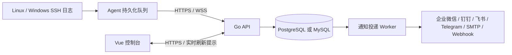

# SSHGuard

面向多服务器环境的 SSH 登录审计与实时告警平台。Go API + Vue 控制台 + 轻量 Go Agent，数据库可选 PostgreSQL 或 MySQL（兼容 5.6.51），Docker Compose 可选。

[一键部署](docs/QUICKSTART.md) · [Agent 安装更新](docs/AGENTS.md) · [告警配置](docs/ALERTING.md) · [生产验收](docs/PRODUCTION.md) · [Releases](https://github.com/xiuzhenzhi/SSH/releases) · [Actions](https://github.com/xiuzhenzhi/SSH/actions)

## 功能

- **安全概览**：在线资产、真实登录趋势、采集健康、待处理告警、通知投递状态；浅色响应式界面、实时刷新、减少动态效果偏好支持。
- **跨平台采集**：Windows OpenSSH/Operational，Ubuntu / Debian journal 或 auth.log，Alpine / Linux secure、messages；成功与失败认证、日志读取位置持久化。
- **可靠上报**：HTTPS + WebSocket；先保存到本地队列，事务提交后确认；断线重连、HTTPS 回退、同一事件 ID 去重。
- **检测与告警**：登录、root / Administrator 登录、认证失败阈值、Agent 离线、采集异常；分组、可信 CIDR、冷却时间、告警确认与健康恢复状态。
- **全部六类渠道**：企业微信、钉钉、飞书、Telegram、SMTP、通用 Webhook；加密保存配置、测试通知、持久化投递队列、重试和失败记录。
- **安装和更新**：后台生成一键命令，Agent 校验下载、保留身份更新、启动失败回退；中央平台原生部署向导或 Compose。
- **权限与运维**：admin / operator / viewer、会话撤销、修改密码、操作审计、过期数据分批清理。

Agent 主动出站连接平台，不保存服务器 SSH 密码或私钥，不接收任意远程 Shell 指令。版本由仓库 VERSION 与 Release 标签控制；仅从成功的 Actions 构建或已发布 Release 安装。生产适用性须按 [验收清单](docs/PRODUCTION.md) 在自己的目标系统验证，验证范围见 [验证记录](docs/VALIDATION.md)。

## 一键部署（无需 Docker）


*开发验收截图，包含隔离测试数据，不是生产服务器监控结果。*

中央平台推荐 Ubuntu / Debian + systemd。准备解析到平台主机的域名、80/443 端口和可信 HTTPS；私有仓库使用有权限的 GitHub 账号，先完成 gh auth login。

```sh
git clone https://github.com/xiuzhenzhi/SSH.git
cd SSH
sh scripts/quick-start.sh
```

向导下载固定版本、校验 SHA256、配置 systemd / Nginx / HTTPS。数据库选择自动安装 PostgreSQL，或填写已有 PostgreSQL / MySQL DSN。初始管理员密码及通知加密密钥保存在 root 专用的 /etc/sshguard/api.env。

更新平台：`sh scripts/quick-start.sh --update`。先备份数据库与 api.env，再更新平台、最后分批更新 Agent。自动回退恢复程序，**不逆向恢复数据库迁移**。离线包、无人值守配置、证书和迁移说明见 [快速开始](docs/QUICKSTART.md)。

## Compose（可选）

```sh
git clone https://github.com/xiuzhenzhi/SSH.git
cd SSH
node scripts/init-env.mjs mysql http://localhost:8088
docker compose config --quiet
docker compose up -d --build
```

打开 http://localhost:8088，用户名 admin，随机密码在 .env。PostgreSQL 将 mysql 改成 postgres；生成器拒绝覆盖已有 .env。本地 HTTP 仅用于体验，接入 Agent 必须启用可信 HTTPS。公网配置见 [Compose 安装](docs/INSTALL-COMPOSE.md)。已有 MySQL 5.6 使用外部数据库，不会自动升级你的数据库。

## 接入第一台服务器

1. 登录控制台，在「服务器管理」新增服务器。
2. 点击「安装命令」，选择 Windows / Ubuntu / Debian / Alpine，在目标机器以管理员/root 执行。
3. 检查服务器在线且「采集正常」，发起一次实际 SSH 登录，核对用户、来源 IP、结果和时间。
4. 在「通知渠道」配置接收方式并发送测试，确认「投递记录」已送达。
5. 在「检测规则」调整分组、可信来源和冷却时间，再验证登录触发的真实通知。

更新 Agent 使用「更新命令」，不重新注册。重装命令会轮换身份凭证。首次采集从安装时的日志尾部开始，不自动灌入历史日志；从已有读取位置恢复时会补传积压。详见 [Agent 手册](docs/AGENTS.md)。

## 架构与可靠性



事件、告警和通知任务在同一数据库事务中保存。Agent 仅在匹配的确认后删除本地事件；网络断开不丢弃未确认记录。通知投递采用租约、限速和退避重试，属于**至少一次投递**：外部渠道已接受但响应丢失时仍可能出现重复通知。通用 Webhook 的 Idempotency-Key 和邮件 Message-ID 可辅助去重。协议见 [HTTPS + WebSocket](docs/TRANSPORT.md)。

## 部署与数据库选择

| 项目 | 支持 |
|---|---|
| 中央平台 | Linux amd64 / arm64；Go 二进制 + systemd + Nginx，或 Compose |
| Agent | Windows / Ubuntu / Debian / Alpine，amd64 / arm64 |
| 数据库 | PostgreSQL 16；MySQL 5.6.51 / 8.4；MySQL 5.6 不使用 JSON、SKIP LOCKED 等新版本特性 |
| 运行依赖 | 发布包无需 Go / Node；不依赖 Redis；Linux Agent 静态构建兼容 glibc / musl |

MySQL 5.6 已停止官方维护，兼容旧版本不等于修复数据库自身漏洞。新部署优先选择维护中的版本，已有 5.6 限制网络访问并制定升级计划。

## 文档与构建

| 文档 | 内容 |
|---|---|
| [快速开始](docs/QUICKSTART.md) | 一键部署、升级、MySQL、HTTPS、回退 |
| [原生安装](docs/INSTALL-NATIVE.md) / [Compose](docs/INSTALL-COMPOSE.md) | 手工部署与配置 |
| [Agent 手册](docs/AGENTS.md) | 采集源、权限、安装更新、诊断 |
| [告警配置](docs/ALERTING.md) | 六类渠道、规则、加密、测试、重试 |
| [协议](docs/TRANSPORT.md) / [API](docs/API.md) | HTTPS / WebSocket、确认、接口与权限 |
| [生产验收](docs/PRODUCTION.md) / [运维](docs/OPERATIONS.md) | 分批上线、备份恢复、保留期 |
| [故障排查](docs/TROUBLESHOOTING.md) / [验证记录](docs/VALIDATION.md) | 问题定位与验证边界 |
| [开发](docs/DEVELOPMENT.md) / [发布](docs/RELEASING.md) | 本地构建、Actions、发布产物 |
| [路线图](docs/ROADMAP.md) / [更新日志](CHANGELOG.md) | 产品范围与版本变化 |

Actions 自动测试、检查漏洞、构建两个平台包和四个 Agent，生成 SHA256SUMS。标签发布先执行完整 CI，通过后才上传 Release；不会自动操作你的生产服务器。提交规范见 [CONTRIBUTING.md](CONTRIBUTING.md)，安全问题见 [SECURITY.md](SECURITY.md)。
