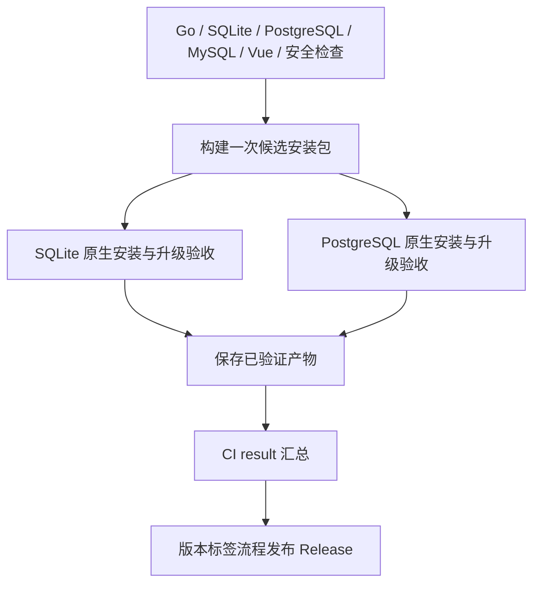

# 构建、版本与 GitHub Actions

## Actions 入口

| 工作流 | 触发方式 | 结果 |
|---|---|---|
| CI | PR、push 到 main、Run workflow | 按改动范围检查；手动勾选 full_validation 才打包并验收安装升级 |
| 构建与发布 | push `v*` 标签；Run workflow 选择分支并可选填写版本 | 手动运行先准备版本提交与标签，再复用完整 CI，最后创建带附件的 GitHub Release |



日常 CI 不重复执行完整发布矩阵。纯文档改动只检查链接与流程工具，纯前端改动增加前端构建，后端及部署相关改动执行跨平台、数据库和安全检查。发布或手动勾选 full_validation 时无论文件范围都运行完整检查。

构建前检查失败则不生成候选包；任一安装验收失败则不生成正式产物。候选包名 `sshguard-build-candidate`，仅用于排查、保存 3 天；通过验收的包名 `sshguard-release-assets`，保存 14 天。发布使用同一次工作流内验证过的文件，不重新编译。可将固定名称 `CI result` 设为分支保护所需检查；它区分按范围跳过与失败，仓库权限规则不会由工作流自动修改。

## 日常 CI

`.github/workflows/ci.yml` 在 main push、PR、workflow_dispatch 时运行，也被 Release 工作流复用：

1. Ubuntu/Windows：Go 测试和 vet；Linux 一次执行全套 race 测试，不再先重复普通测试；Windows 执行 SCM 服务和安装器 ACL 检查。
2. 三个独立服务容器：PostgreSQL 16、MySQL 5.6.51 / 8.4，执行真实数据库 API 集成测试。
3. 前端：npm ci、TypeScript/Vite 构建、high 级别依赖漏洞检查。
4. 完整验证模式才构建两个 Linux API 架构与四个 Agent。前端复用本次前端任务的产物，四个 Agent 构建一次并复用于两个平台包；校验 ELF/PE、静态链接和 SHA-256。五组临时 Linux runner 验证 SQLite / PostgreSQL、直连 / 反代、systemd / Alpine OpenRC 安装、更新与失败恢复，通过后保存产物。PR 与普通 main 提交不上传安装包。
5. `CI result` 汇总所有适用任务结果，避免上游失败后下游跳过被误认为整体成功；工作流本身也通过 actionlint 检查。

流程没有生产凭证；CI 数据库密码只在临时测试容器内使用。不要把生产环境连接串放进 workflow。未通过检查不会发布安装产物。

Dependabot 按周分组提交 Go/npm 的 minor/patch 更新，不自动合并；major 升级单独评估改动影响。PR 检查失败不会影响已验证的 main/Release，也不能绕过检查直接合并。

## 产物

| 名称 | 用途 |
|---|---|
| sshguard-linux-amd64.tar.gz / sshguard-linux-arm64.tar.gz | 中央平台，包含 API、Web、全部 Agent 和文档 |
| sshguard-agent-linux-amd64 / linux-arm64 | Ubuntu/Debian/Alpine 共用静态二进制 |
| sshguard-agent-windows-amd64.exe / windows-arm64.exe | Windows 原生服务二进制 |
| install-agent.sh / install-agent.ps1 | 后台安装命令所下载的脚本 |
| uninstall-agent.sh / uninstall-agent.ps1 | 保留配置与日志的服务卸载脚本 |
| deploy.sh / quick-start.sh / update.sh / uninstall.sh | 主控安装、菜单管理、一键更新与卸载入口；同时包含在原生发行包中 |
| 单个 .sha256 / SHA256SUMS | 单文件及总清单完整性校验 |

Actions Artifact 是一次构建快照，保存 14 天；Release 是命名版本供部署使用。仓库私有时两者都需要访问权限。自动构建成功不代表已经在每个目标系统实机安装验证；ARM64 默认交叉编译。

## 创建版本

### 推荐：从 Actions 一键发布

1. 打开 Actions → **构建与发布** → **Run workflow**。
2. 选择需要发布的分支（通常为 `main`）。
3. 版本号可留空：自动参考该分支历史中的已发布稳定 Release 和当前 `VERSION`，取较高版本递增补丁号，并跳过已有标签。例如当前为 `0.3.10`，下一版通常为 `0.3.11`。其他分支独有的 Release、草稿和预发布不会影响自动计算。
4. 也可填写 `0.4.0` 或 `0.4.0-rc.1`；`v` 前缀可省略。已有版本标签会被拒绝，不会覆盖。
5. 工作流更新版本文件、一键安装默认版本、安装示例、更新日志和发布说明，提交回所选分支并原子推送新标签。后续测试与构建固定到该版本提交，避免分支继续变化影响产物。
6. 等待完整验收与发布完成，在 Releases 下载包与 `SHA256SUMS`。自动生成的发布说明使用提交摘要，发布前应保持提交信息清晰。

该入口需要仓库允许 Actions 写入内容。受保护分支如果禁止机器人提交，准备步骤会失败，不会绕过保护；此时按下面的手动提交/打标签流程发布。准备步骤使用 `GITHUB_TOKEN` 推送不会递归触发另一条发布流程，因此本次工作流会直接继续完整 CI 和上传。

准备成功后若测试或网络失败，使用当前运行的 **Re-run failed jobs**，继续同一个版本；不要再次留空新建另一个版本来代替排错。已发布的标签和附件不可覆盖。

### 手动提交与打标签

1. 修改 `VERSION`、`scripts/quick-start.sh` 首次安装默认标签及版本文档，例如 `0.3.10`，版本长度不超过 32。更新入口默认解析最新正式 Release，不依赖这个安装标签。
2. 更新 CHANGELOG、docs/RELEASE-NOTES.md 和验收记录。
3. 提交到 main，等待 CI 全部通过。
4. 在对应提交创建并推送标签：

```bash
git tag -a v0.3.10 -m "SSHGuard 0.3.10"
git push origin v0.3.10
```

Release 工作流检查标签与 VERSION 完全一致，再复用 CI、下载并校验产物，最后创建 Release。含连字符（例如 -rc.1）的标签标为 Prerelease，无连字符的标签发布普通版本。发布前须完成对应版本验收；目标生产环境仍需按生产清单分批上线。

只构建快照而不发布：Actions → CI → Run workflow，选择目标分支并勾选 full_validation；留空时只运行代码检查。已有标签可在原运行中使用 Re-run failed jobs；包含手动入口的标签也可选择该标签运行，版本输入留空。相同分支/标签的发布串行运行，不会因重复触发取消正在进行的上传。仅版本准备和发布任务持有仓库内容写权限，测试与构建使用只读权限。

**不要移动已发布标签或覆盖同名二进制。** 修复使用新版本。发布任务因网络错误中断时先检查 Release 是否已经创建、附件是否完整；不要直接覆盖已有资产。不同源代码不得复用已发布的版本名。

## 本地复现

```bash
node scripts/build-release.mjs amd64
node scripts/build-release.mjs arm64 --reuse-web --reuse-agents
node scripts/check-agent-artifacts.mjs
node scripts/package-release.mjs
```

输出为 dist/release。Agent 的 `-version` 和健康接口中的 version 可识别构建版本。VERSION 通过链接参数注入；源码直接 go run 使用代码内的开发默认值。

--reuse-agents 仅用于同一次构建的 arm64 包，要求先生成同版本 amd64 包，期间不能改动 Agent 源码；复制前重新校验全部 Agent。独立构建任一架构时不要使用该选项。

SHA-256 清单校验下载完整性，不是代码签名或独立的发布者身份认证。当前 Windows 程序未做 Authenticode 签名，按组织终端管理要求部署；不会关闭系统安全保护。

参考：[GitHub artifact](https://github.com/actions/upload-artifact)、[setup-go](https://github.com/actions/setup-go)。
